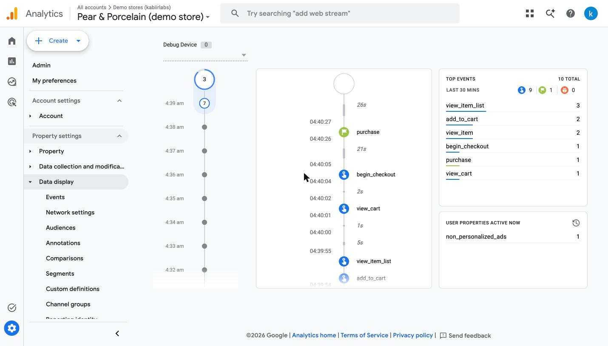

# Pear & Porcelain: a live WooCommerce demo store

**Live: https://shop.kabiirlabs.com** · a fictional porcelain shop you can browse, add to cart and check out (test
payment only). It exists to show, on a real store, the work WooCommerce clients ask for: a polished block theme,
measured speed fixes, security hardening and GA4 ecommerce tracking through Google Tag Manager.


## Real vs simulated

| Part | Status |
|---|---|
| WordPress 7.1.4, WooCommerce 11.2.2, the theme, cart, checkout, orders | **Real**, in Docker (Apache + PHP 8.3, MariaDB 11.4, Redis 7.4) on a Mac, published through a Cloudflare tunnel |
| Payment | **Test only.** WooCommerce "Cash on delivery", relabelled "Test payment (no money is taken)". No payment provider is connected |
| Shop, products, prices | **Made up.** Product photos are public-domain (CC0) objects from the Rijksmuseum, Amsterdam; each product page links to its source |
| Orders placed by visitors | **Real test orders** in the database, deleted after 24 hours. No email is sent to anyone |
| The slow "before" state | **Simulated on purpose:** real wordpress.org plugins (MetaSlider, Font Awesome, Contact Form 7) plus a must-use plugin that recreates common theme mistakes, and a database filled with made-up revisions, expired transients, spam and leftovers |
| Speed numbers | **Real measurements**, Lighthouse 13.5, 3 runs per page and device, medians |
| Security checks | **Real**, 31 automated checks run against the live stack (`tests/security.sh`) |
| GA4 and GTM | **Real** Google accounts: container `GTM-WBDM5JQ9`, GA4 property `G-0MCNTZPGY7`, used only for this demo. Events confirmed in GA4 Realtime and GA4 DebugView (see [docs/TRACKING.md](docs/TRACKING.md)) |
| Hosting | One Mac at home. Not a production host: if the Mac sleeps, the demo is down |

## Speed: before and after

Lighthouse 13.5, median of 3 runs, measured on the server (`http://127.0.0.1:8081`, no CDN in between), 2026-11-08.
Phone = Lighthouse's simulated mid-range phone on slow 4G. Full tables and every run's score: [reports/SPEED.md](reports/SPEED.md).

| Page | Performance | Largest Contentful Paint | Page weight | Server response |
|---|---|---|---|---|
| Home, phone | 63 → **94** | 17.8 s → **2.8 s** | 3.6 MB → **0.5 MB** | 2512 ms → **28 ms** |
| Shop, phone | 62 → **82** | 17.4 s → **4.3 s** | 4.3 MB → **0.7 MB** | 3587 ms → **22 ms** |
| Product, phone | 65 → **79** | 11.6 s → **4.8 s** | 1.7 MB → **0.7 MB** | 1713 ms → **18 ms** |
| Home, desktop | 76 → **99** | 3.0 s → **0.9 s** | 3.6 MB → **0.6 MB** | 1999 ms → **19 ms** |
| Shop, desktop | 74 → **99** | 3.2 s → **0.9 s** | 4.3 MB → **0.8 MB** | 3395 ms → **16 ms** |
| Product, desktop | 83 → **99** | 2.2 s → **0.9 s** | 1.7 MB → **0.6 MB** | 1913 ms → **18 ms** |

After the speed work, accessibility was 100 (97 on the product page) and best practices 100. SEO was 92 (no meta description),
and the product page's sale badge failed colour contrast. Both were fixed after the measured run and were not re-measured.

**What the "before" state does** (`scripts/state-before.sh`): a MetaSlider hero with three full-size photos; Font
Awesome and Contact Form 7 loading on every page; four Google Fonts families in many weights; jQuery UI and
WooCommerce's cart-fragments script on every page; every photo printed at its 3000 px original size with no `srcset`
and no lazy loading; no page cache, no object cache, no compression or browser caching; a database with 1,320 old
revisions, 15,000 expired transients, 3,000 spam comments, 20,000 orphaned meta rows, 25,000 finished background jobs
and 2.5 MB of autoloaded options left by removed plugins.

**The fixes** (`scripts/state-after.sh`, `wp-content/mu-plugins/pp-performance.php`):

| Fix | How |
|---|---|
| Slider out, one optimised hero image | cover block with `srcset`, `fetchpriority="high"` and a preload |
| Plugins only where used | Font Awesome and MetaSlider removed; Contact Form 7 scripts and styles only on `/contact/` |
| Images | every size regenerated as WebP (quality 78), originals capped at 2000 px, lazy loading below the first image, right `sizes` for the category tiles |
| Fonts | self-hosted, cut to Latin characters with fonttools (Manrope 55 → 24 KB, Vollkorn 191 → 70 KB), body font preloaded, `font-display: swap` |
| Scripts and CSS | deferred with WordPress's own loading-strategy API (not on cart/checkout, where it breaks the block checkout); jQuery and WooCommerce's classic scripts and CSS dropped on the block-only home page; small stylesheets inlined |
| Page cache | WP Super Cache (simple mode), with cart, checkout, account and visitors with a cart excluded |
| Object cache | Redis (Redis Object Cache plugin) |
| Server | gzip, one-year immutable caching for static files (`.htaccess`) |
| Database | cleanup with a before/after report ([reports/db-cleanup.txt](reports/db-cleanup.txt)): 58 MB → 10 MB, autoloaded options 2,561 KB → 69 KB; backup taken first |
| Cron | WordPress's page-view cron replaced by a container that runs due events every minute |

**Three problems found while building it**, all fixed:
- WP Super Cache served only the home page from cache. Without `$wp_cache_slash_check` it skips every URL ending in
  "/", and the settings screen that normally sets it was never opened.
- Deferring every script broke the block checkout: WordPress delays a deferred script's inline set-up code too.
- A notice added in front of the checkout block stopped it loading, because WooCommerce tags the first element of the
  block's HTML.

## Security

31 checks in [tests/security.sh](tests/security.sh); **13 of 31 pass before, 31 of 31 after**
([before](reports/security-before.txt), [after](reports/security-after.txt)). The checklist, with why and where for
each item, is [docs/SECURITY.md](docs/SECURITY.md). It covers security headers (CSP, HSTS, nosniff, frame options,
referrer and permissions policies), blocked config, log and readme files, XML-RPC off, no user-name discovery, no PHP in
uploads, file editor off, a non-default admin name with a long random password, login attempts limited, the admin area
closed on the public address, unknown Host headers refused, the database not published, core checksums, and backups
with a restore test.

## Tracking

GA4 ecommerce events through Google Tag Manager with Consent Mode v2: `view_item_list`, `view_item`, `add_to_cart`,
`remove_from_cart`, `view_cart`, `begin_checkout`, `purchase` (once per order, never on reload). The cart events work
with the page cache because they are queued in the visitor's session and collected by the browser. Details and the
verification are in [docs/TRACKING.md](docs/TRACKING.md). The automated walk passes the 11 checks of my
[tracking-kit](https://github.com/kabxxr7-jpg/tracking-kit) validator, and GA4 DebugView shows the whole funnel in the real property:



## Run it

Needs Docker (Desktop or Colima), python3 and Node 22+.

```bash
scripts/setup.sh            # builds the image, installs WordPress + WooCommerce, seeds 26 products, switches to the fixed state
npm ci
tests/smoke.sh              # pages + a test order through the Store API
tests/security.sh           # the 31 hardening checks
npx tsx tests/tracking/walk.ts          # GA4 dataLayer events, Google requests answered locally
scripts/state-before.sh     # slow + unhardened, for measuring
scripts/measure-all.sh      # before -> Lighthouse x3 + security -> after -> Lighthouse x3 + security (~30 min)
scripts/backup.sh           # database + uploads, restored into a scratch database to prove it works
```

The store answers on `http://127.0.0.1:8081` (admin there; user and password are generated into `.env`) and on the
public host set in `.env` (`STORE_PUBLIC_HOST`), which a tunnel or proxy must route to that port. Tracking IDs go in
`.env` (`GTM_ID`, `GA4_ID`); without them no tag is printed. Versions: [docs/VERSIONS.md](docs/VERSIONS.md).

CI ([.github/workflows/ci.yml](.github/workflows/ci.yml)) lints PHP, shell and JSON, then builds the whole stack from
scratch on Ubuntu. It runs the smoke, security and tracking tests, then switches to the "before" state and checks that
the security tests fail there.

## Layout

```
docker-compose.yml          wordpress (Apache + PHP 8.3 + WP-CLI + phpredis), mariadb, redis, cron; only 127.0.0.1:8081 published
config/wp-config-extra.php  host allow-list (local + public), HTTPS behind the tunnel, hardening constants
wp-content/mu-plugins/      store core (demo labels, no email, order clean-up), speed before/after, security, tracking
wp-content/themes/pear-porcelain/   child theme of Twenty Twenty-Five (block theme, light and dark)
scripts/                    setup, state-before/after, Lighthouse runner, backup, screenshots; scripts/wp/ runs inside the container
tests/                      smoke.sh, security.sh, tracking/walk.ts (+ tracking-kit validator)
gtm/container.json          the GTM container (import file)
reports/                    Lighthouse summaries, SPEED.md, security results, DB clean-up report, GA4 screenshots
```

## What this does not prove

Everything here runs on one Mac, measured on the server itself. A real host adds network distance, its own caching and
PHP limits. The traffic is a handful of test visits, not real customers. No payment provider is connected. The slow
state was built by me to look like typical stores, not taken from a client.

Product photos: Rijksmuseum, Amsterdam, public domain (CC0), via Openverse. Fonts: Manrope and Vollkorn, SIL Open Font
License 1.1 (subsets, see `wp-content/themes/pear-porcelain/assets/fonts/README.md`). Code: MIT ([LICENSE](LICENSE)).
